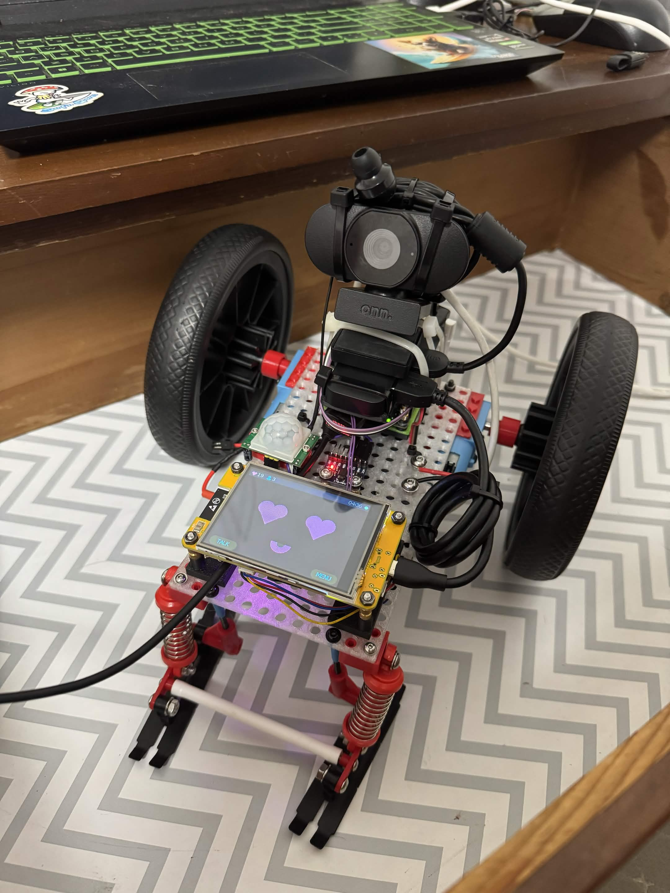

# Pip: a little home robot you can build, teach and take apart

Pip is a small, modular, AI-powered robot built from cheap hobby boards. It sees, hears, talks, remembers, drives on
two wheels, pops wheelies, plays games on its own touchscreen face, and can change its own software when you ask it to.

Everything is here: the software, both firmwares, the manual the robot reads about itself, and (soon) the printable
body. Build one, teach it a trick, bolt new hardware on, and send the change back.

Project page: <https://pip.xrtech.dev/>



## What it can do

- **A face and a voice.** Animated eyes and mouth on a 2.8" touchscreen. It listens through the webcam's microphone
  (a cloud speech-to-text model by default, the offline Vosk model as a fallback or by choice) and speaks through a
  Bluetooth speaker or a tiny earpiece.
- **Sees.** A USB webcam: look and describe, read text, count faces and smiles, read QR codes, follow you with its eyes.
- **Thinks with the model you choose.** Claude through the Anthropic API or any OpenRouter model; switch from the
  screen or the web app, compare them on the robot's own benchmark, and keep one personality and one memory across all.
- **Remembers.** Long-term memory, a conversation journal, notes about the people it lives with (from what you tell
  it, never from faces).
- **RoboOS.** A tiny retro desktop on the touchscreen (USB mouse and keyboard work): terminal, files, notepad, text web
  browser, music, paint, system monitor, weather, battery, and games (checkers and tic-tac-toe against the robot,
  a minesweeper, a maze-chase game, and a Game Boy emulator for your own games).
- **RoboDev.** A coding agent that lives on the robot. Ask by voice or text for a new app or a fix: it edits the code,
  commits, restarts, and rolls back by itself if the robot does not come up healthy. Risky steps wait for your tap.
- **Drives.** Two wheels, a joystick in the web app, and a wheelie: it kicks up and balances on two wheels.
- **A web app.** Live camera, chat, settings, files, photos; from your phone at home, or from anywhere through a tunnel.
- **Shares its life (if you let it).** Posts to Bluesky with faces blurred and a safety check; has its own email
  inbox where every send needs your approval.
- **Looks after itself.** Self-tests for every part, battery monitoring with clean shutdown, firmware flashing with
  a backup first.
- **Talks to other AIs.** An MCP server (`mcp/robot_mcp.py`) lets Claude Code, Claude Desktop and other agents see and
  act through the robot.

## The body

| Part | Role |
|---|---|
| Orange Pi Zero (H2+, 512 MB, Armbian) | brain: runs `robotd` |
| ESP32 "Cheap Yellow Display" (ESP32-2432S028R) | face, touchscreen, earpiece, I2C port |
| RP2040 Zero + L293D board ([cperos-xr/l293d](https://github.com/cperos-xr/l293d)) | 8 motor channels, 500 ms failsafe, reads the IMU for wheelies |
| USB webcam with microphone | eyes and ears |
| MPU-6050 (GY-521), PCF8574, PIR sensor, INA219 | balance, spare I/O, motion, battery monitor |
| 2 gear motors + wheels, 3S battery pack, 5 V and 7.5 V regulators | getting around |
| USB hub, USB Bluetooth dongle, Bluetooth speaker | plumbing and a louder voice |

Wiring, pins and the hard-won lessons are in [`knowledge/manual/body.md`](knowledge/manual/body.md). Printable parts
go in [`cad/`](cad/README.md).

## Build your own

1. **Put it together:** [`knowledge/manual/body.md`](knowledge/manual/body.md).
2. **Install the software:** [`docs/INSTALL.md`](docs/INSTALL.md).
3. **Give it a brain:** one API key (OpenRouter or Anthropic) in `data/secrets.env`
   ([template](tools/secrets.env.template)).
4. **Meet it:** open `http://pip.local:8080`, pair your phone with the QR code on its screen, and say hello.

## Where things are

```
robotd/            the robot's program (Python): face link, motors, sensors, camera, voice, AI, memory, web app, API
  brain.py         the AI mind and its tools          agent.py     RoboDev, the on-board coding agent
  desktop*.py      RoboOS and its apps                api.py       web app + HTTP API      webauth.py  sign-in
  web/             the web app (plain HTML and JavaScript, no build step)
firmware/          Arduino sources: cyd_dashboard (ESP32 screen), rp2040_motor_usb (motor board)
knowledge/manual/  the manual, written for the AIs that run and change the robot (people can read it too)
knowledge/         hardware.yaml (the robot's model of its own body), personality.md, photos
mcp/robot_mcp.py   MCP server for Claude Code and other agents
tools/             safe restart, privacy scan, install helpers
docs/              install guide, the original design notes
site/              the project's web page
```

## Teach it something

The fastest way in is the manual: start at [`knowledge/manual/README.md`](knowledge/manual/README.md), then
`changing_things.md`. Ideas that fit in an afternoon: a new RoboOS app or game (`roboos.md`), a new self-test, a new
trick for the wheels (`motors.md`), a new sensor on the I2C port (`body.md`). See [CONTRIBUTING.md](CONTRIBUTING.md).

## Safety and privacy, by design

- Motors stay locked until the owner unlocks them, and the motor board stops by itself after 0.5 s without commands.
- Flashing firmware, deleting data and other risky steps ask on the touchscreen first. Self-edits are git commits, and
  a failed restart rolls back to the last good one.
- The camera has a privacy switch on the screen. Nothing is public unless the owner turns it on.
- Each robot's private life (keys, memory, photos, its home network, its owner's wishes) lives in `data/`, which is
  never committed. `tools/privacy_scan.py` checks every commit for secrets and personal details.
- The web app needs a password, a QR pairing from the robot's own screen, or the API token; guessing is rate limited.

Found a security problem? Please read [SECURITY.md](SECURITY.md).

## License

Code: [MIT](LICENSE). Manual, photos, web page and 3D models: [CC BY 4.0](https://creativecommons.org/licenses/by/4.0/).
The details, and the few third-party files: [NOTICE.md](NOTICE.md).
