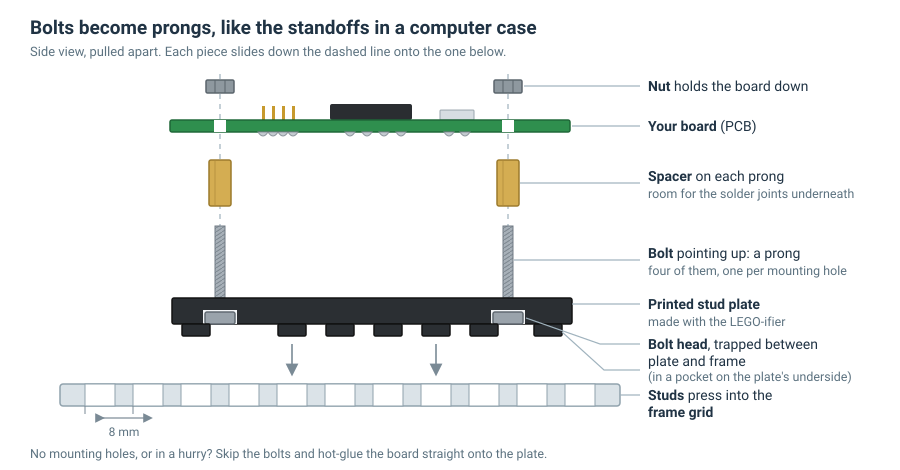

# Mounting boards on Pip

Pip's frame is a grid with 8 mm between centres: the first Pip uses perforated plastic plates and LEGO bricks.
Every board sits on a printed **stud plate** whose studs press into that grid. Make a plate for any board, in any
size, with the **LEGO-ifier**:

- Online: `legoifier.html` on the project's web page (the same folder as the main page).
- In this repo: [`site/legoifier.html`](../site/legoifier.html). Open it in any browser. It works offline.

It gives you a ready-to-print **STL** (plate, studs and bolt holes), or the exact values to draw the plate yourself
in Fusion 360.

## 1. Calibrate first: print a small one and make sure it fits

Every printer, filament and frame is a little different. The default stud diameter (5.00 mm) fits the first Pip's grid
on its printer. Yours may need 4.9 or 5.1.

1. In the LEGO-ifier, **Download calibration strip**. It is five snap-off tabs with one stud each, from 0.2 mm under
   to 0.2 mm over your current setting. The dots count the size: 1 dot = smallest, 3 dots = current, 5 dots = largest.
2. Print it studs up.
3. Press each tab into a hole of your frame (or into the underside of a LEGO brick). The right one goes in with a
   firm push, stays put when you turn it upside down, and comes out by hand.
4. Put that size in **Stud diameter** (each dot is 0.1 mm), then print the **2 × 2 test plate** to check the spacing
   too. If it fits, every plate you make with these settings will.

## 2. Make the plate

- **Width and length:** the board's size, or a little bigger. Bigger plates hold better.
- **Bolt holes:** if the board has mounting holes, tick *Bolt holes* and enter the hole spacing (centre to centre),
  from the board's drawing or a ruler. Hole size: 2.2 mm for M2 bolts, 2.7 for M2.5, 3.2 for M3.
- **Head pocket:** a recess on the stud side for each bolt head, so the plate still sits flat on the frame. Make the
  plate about 1.6 mm thicker than the pocket is deep (the tool does this for you).
- Studs that would hit a hole are left out automatically.
- Print it studs up (the board side flat on the bed): 0.2 mm layers, 3 walls, PLA or PETG.

## 3. Mount the board

Use whatever is in the drawer. The first Pip uses all three of these.

### Bolts as prongs (boards with screw holes)

It is the same idea as the standoffs in a computer case:

1. Push four bolts up through the plate from underneath, heads in the pockets. The heads end up trapped between the
   plate and the frame, and the bolts stick straight up like prongs.
2. Slide a **spacer** onto each prong: a nylon or brass spacer, a stack of nuts, or a short piece of drinking straw.
   The spacers leave room for the solder joints and pins on the underside of the board.
3. Drop the board onto the prongs.
4. A nut on each prong holds it down.
5. Press the plate into the frame.

### Hot glue (in a hurry, or no screw holes)

Turn off the bolt holes, print the plate, and glue the board straight onto it. Put the glue where the board has
nothing underneath, or add a few blobs as feet if there are solder joints in the way. It holds well, and peels off
with a little rubbing alcohol when you want the board back.

### Squishy TPU pads (optional)

If you are not in a rush, print small washers in TPU and put them between the plate and the board, or under the nuts.
They take up a little vibration and stop a bolt from cracking a board. Honestly, they do not add much: bolts and
spacers are plenty.

## For developers: how the STL is made

The LEGO-ifier builds the mesh in the browser with no libraries (`site/legoifier.html`, between `GEOMETRY START` and
`GEOMETRY END`). The plate is one closed shell: its faces are cut on a grid so that each hole sits alone in a square
cell, so there are no T-junctions. The studs are separate closed cylinders sunk 0.2 mm into the plate, which every
slicer merges. If you change that code, check that every edge is shared by exactly two triangles, in opposite
directions, and that the volume is right. Keep the page a single file that works offline.
