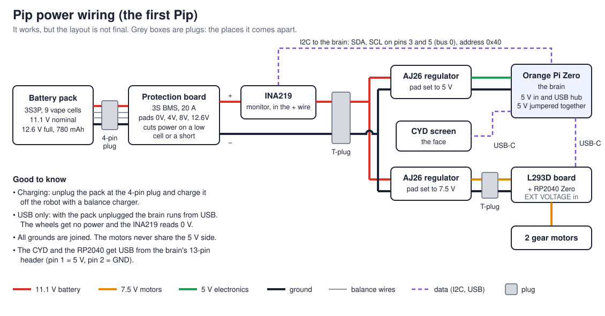
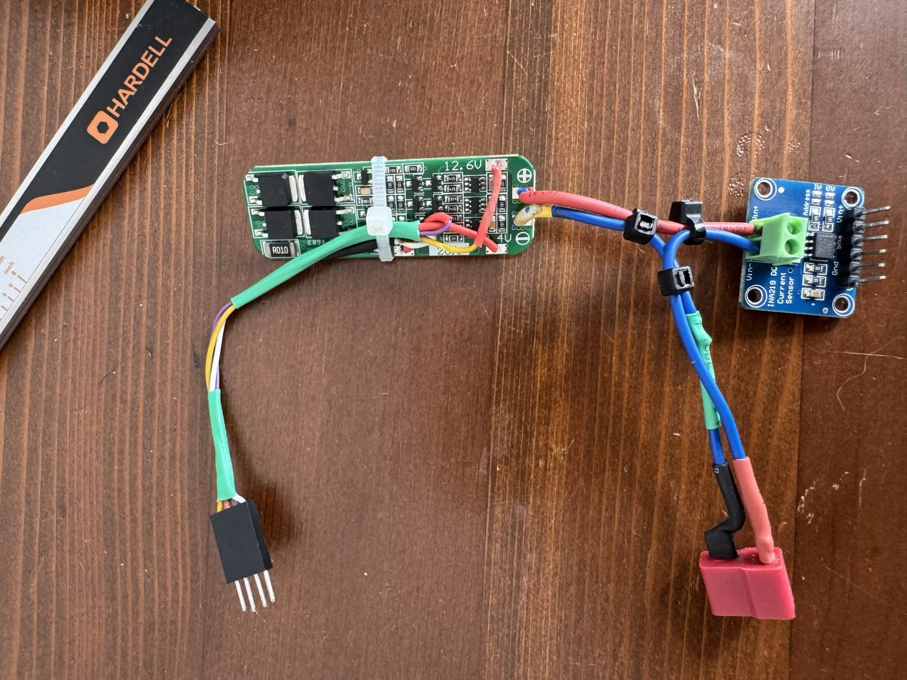
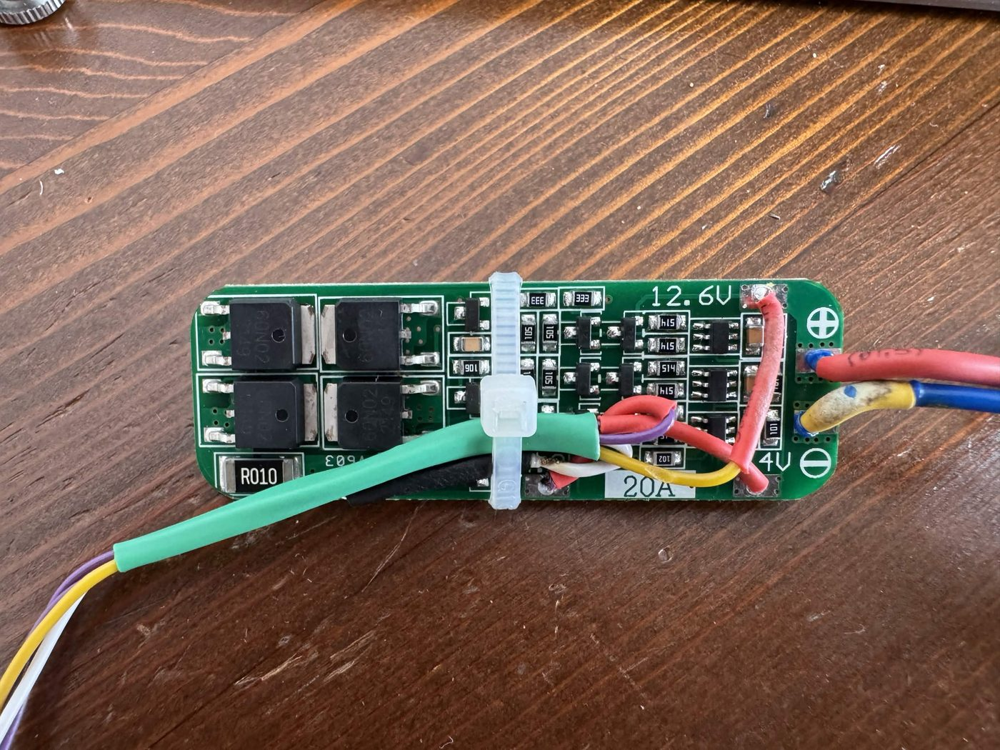
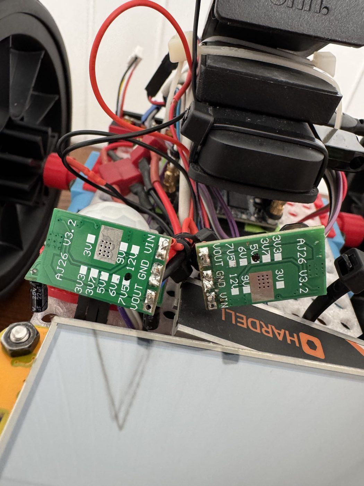
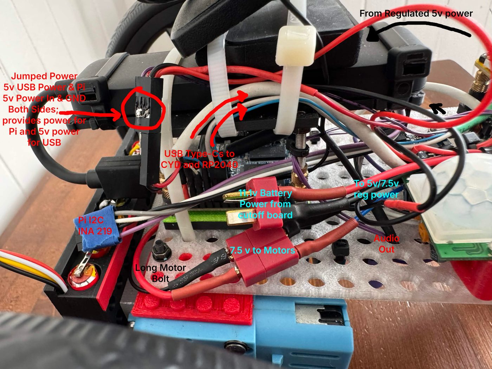
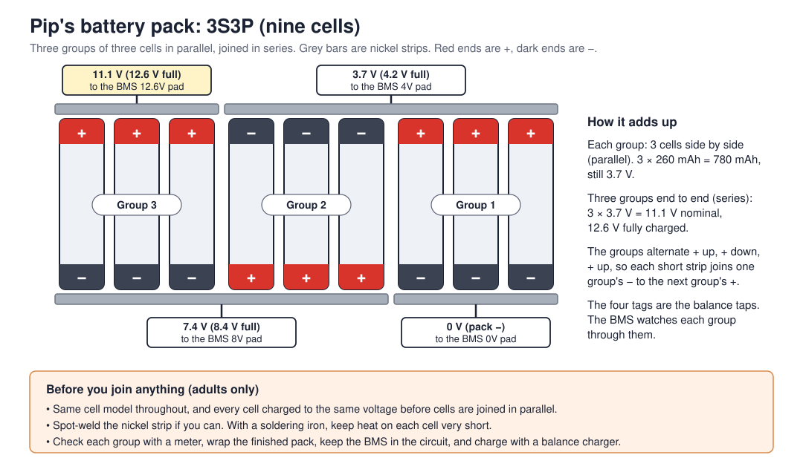
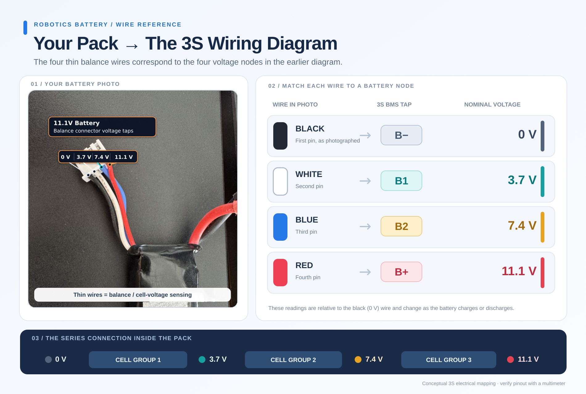
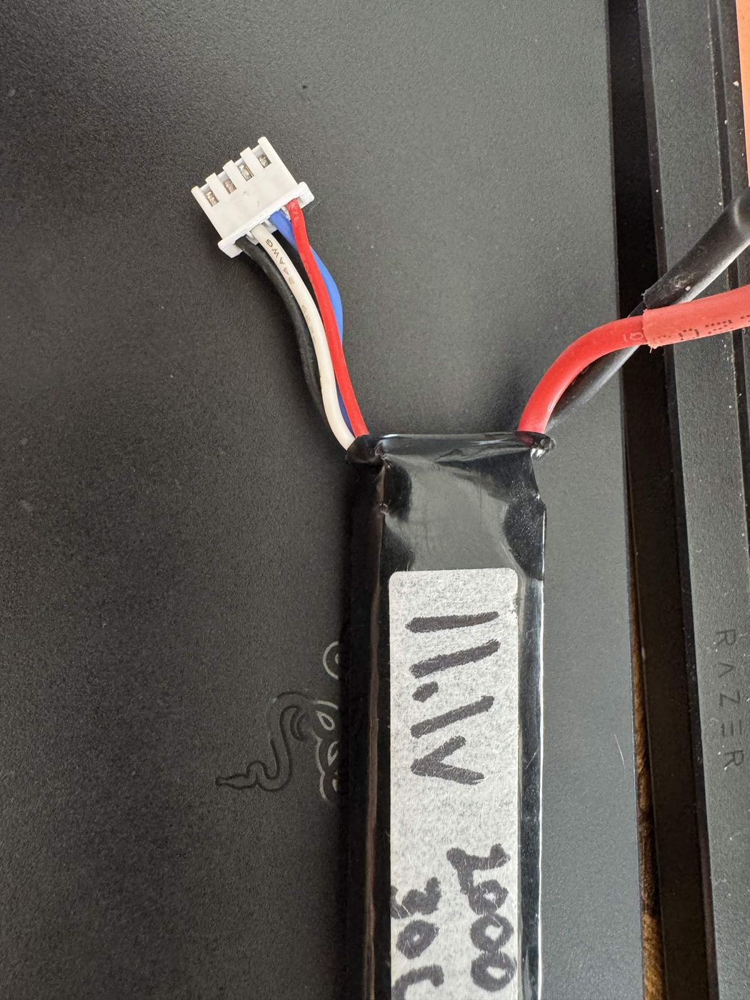
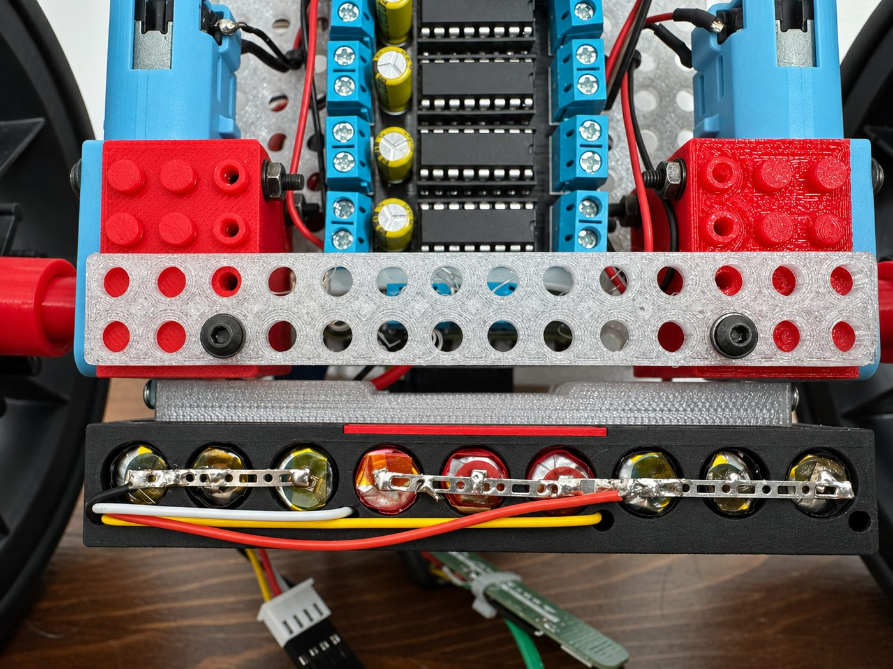
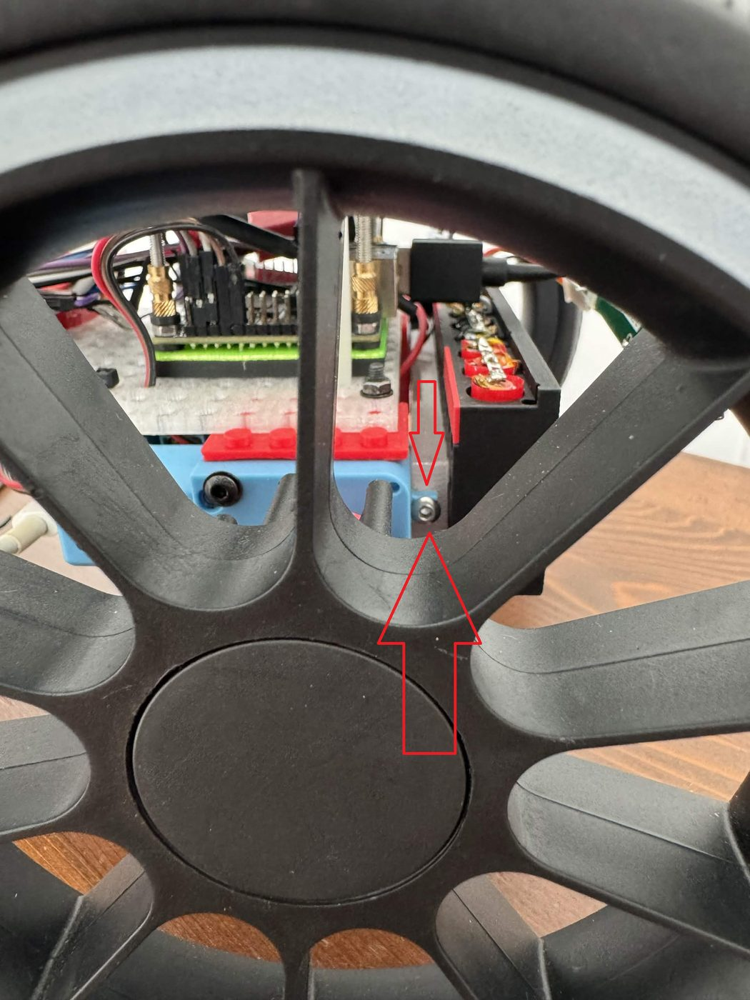

# Powering Pip

Power is the least finished part of Pip. This page is honest about that: it shows what works today, what the first
Pip actually runs on, and the parts that are still open problems. If you solve one, please send it back.

**Short version:** Desk Pip runs from a USB power supply. Rolling Pip needs a battery, and the first Pip uses an
11.1 V (3S) pack with a protection board and two small step-down regulators.

## Option A: USB power (Desk Pip, workshops, kids)

The simplest and safest way to run Pip. Use it for anything without wheels.

- Plug the brain into a **5 V USB supply rated 3 A** (a good phone charger or a Raspberry Pi supply), or a USB power
  bank.
- Power the screen and the webcam from the brain or a **powered** USB hub.
- What you lose: Pip cannot know its battery level from a power bank, and the wheels get no power.

**Random resets are almost always power.** A weak supply or a thin cable makes the brain restart when the camera
or Wi-Fi gets busy. Try a better supply and a shorter, thicker cable before anything else.

## Option B: the first Pip's battery (Rolling Pip)

This is how the first Pip is wired today. It works, but the layout is not final. It grew out of what was in the parts
drawer after the first plan (Option C) did not work.

(The whole robot's circuit, with the brain, screen, sensors and motor board, is in
[WIRING.md](WIRING.md).)

In words: the pack plugs into a **protection board (BMS)**. The BMS output goes through an **INA219** monitor in the
positive wire, then a **T-plug** to the robot's power. There it splits into two small regulators: **5 V** for the brain
and everything on USB, and **7.5 V** (through a second T-plug) for the motor board.

> **Three rules for the first Pip's battery** (your battery system may be different: this is how ours works)
>
> 1. **The pack plugs in by its 4-pin balance plug, not its main (Deans) plug.** The protection board needs all four
>    voltages (0, 3.7, 7.4 and 11.1 V) to watch each cell group, so on the first Pip everything goes through that one
>    plug. Leave the pack's main leads unplugged and cover their connector.
> 2. **Check which side is 0 V and which is 11.1 V every time you plug in.** The plug on the robot side is a plain
>    4-pin header that fits either way round, and the wrong way round puts 11.1 V where 0 V should be. A reversed plug
>    burned out a charger. Mark the 0 V side on both halves (a dot of paint or nail polish), or fit a keyed plug.
> 3. **Never connect a pack without the protection board.** The regulators and the motor board draw power even when
>    nothing moves. With no cutoff they drain the pack until it is ruined: packs left plugged straight into the L293D
>    board were destroyed this way. Unplug the pack when Pip is off.
>
> Running everything through the balance plug works because Pip draws little current (about 0.4 A at idle). Balance
> plugs are made for small currents (a JST-XH plug is rated about 3 A). For bigger motors, use the pack's main leads
> with a protection board that has its own main pads.

### The parts

| Part | What the first Pip uses | Notes |
|---|---|---|
| Battery | Home-made 3S3P pack (nine 260 mAh cells, 780 mAh) | A store-bought 3S Li-ion or LiPo pack works the same. The first Pip also ran on a 3S 1100 mAh airsoft LiPo. |
| Protection board | 3S BMS rated 20 A, with balance pads marked 0V, 4V, 8V and 12.6V | Lives on the robot; the pack plugs into it. The last line of defence: the software shuts the brain down cleanly before the BMS has to cut the power. |
| Monitor | INA219 board, 0.1 ohm shunt, in the positive wire (Vin+ from the BMS, Vin− to the robot) | I2C address 0x40 on the brain's bus 0 (pins 3 and 5). Optional: without it Pip runs fine but does not know its battery level. See `knowledge/manual/battery.md`. |
| 5 V regulator | AJ26 V3.2 step-down module, output pad set to 5 V | Pins: VIN, GND, VOUT. The output is picked by bridging one solder pad (3.3, 3.7, 5, 6, 7.5, 9 or 12 V printed on the board). Feeds the brain's 5 V input and the USB hub, jumpered together. |
| 7.5 V regulator | AJ26 V3.2 step-down module, output pad set to 7.5 V | Feeds only the motor board's EXT VOLTAGE input. Any step-down module works if you check its output with a meter first (LM2596, MP1584 and similar). |
| Plugs | The pack's **4-pin balance plug** into the BMS (never the pack's own Deans plug). Inside the robot, T-plugs (Deans style) for the 11.1 V feed and the 7.5 V motor feed | The plugs are where it comes apart, for charging or for working on one part. Mark the 0 V side of the 4-pin plug. |
| Charger | External balance charger | The pack comes off the robot to charge. |

*The battery unit off the robot. Left: the 4-pin plug the pack connects to. Middle: the 3S protection board. Right: the
INA219 in the positive wire, and the red T-plug that feeds the robot.*

*Close-up of the protection board. The balance wires land on the 0V, 4V, 8V and 12.6V pads. The + and − pads on the
right are the output.*

*The two AJ26 V3.2 regulators. The printed pads (3V3 to 12V) set the output; the three pins are VIN, GND and VOUT.*

### On the robot

*Labelled: the 11.1 V feed from the protection board arrives on a T-plug and goes to both regulators. The 7.5 V motor
feed has its own T-plug. The regulated 5 V feeds the brain's 5 V input and the USB hub's power, jumpered together
on both sides (5 V and GND). USB-C cables take power and data to the CYD screen and the RP2040 motor board. The
INA219's I2C plug (blue tape) goes to the brain.*

**Cable routing, for now:** the cables run under the zip ties that hold the webcam. They make a neat channel. This is
**not** a proper webcam mount: that part is still being designed.

### The battery pack and its mount

*Wire colours differ from pack to pack: measure each one against the black (0 V) wire before you plug it in. On the
first Pip's protection board the taps are marked 0V, 4V, 8V and 12.6V (B−, B1, B2 and B+).*

*A store-bought 3S pack. The white 4-pin balance plug (black 0 V, white, blue, red 11.1 V) is what plugs into Pip.
The thick red and black main leads are not used on our version.*

*The pack sits in a printed holder across the back of the robot, under the L293D board.*

*Seen through the wheel (red arrows): the battery's back mounting plate is fixed to the frame with the centre screw
hole next to the motor.*

### Why 11.1 V (3S)?

Step-down regulators need some headroom above their output. A 3S pack sits at 12.6 V full and about 9.9 V when the
software shuts the robot down (3.3 V per cell), so the 7.5 V regulator stays in range from full to empty. A 2S pack
(8.4 V full) would drop below what the 7.5 V side needs early in the run.

### How long does it last?

The first Pip draws about 0.33 to 0.43 A at idle (around 4 to 5 W), which gives roughly 1.5 to 2 hours on the
780 mAh pack without driving. Driving and wheelies use more. Pip measures each pack's real capacity over time:
Settings > Battery.

### Battery safety

Lithium cells store a lot of energy. These rules are not optional.

- Charge with a **balance charger**, on a fireproof surface, and never leave it charging unattended.
- Keep the **protection board** in the circuit. Never bypass it, and never plug a pack straight into the regulators or
  the motor board: they drain it even when Pip is still.
- **Check the plug's direction** (0 V to 0 V) before you plug a pack into the robot or the charger. A reversed plug
  burned out a charger.
- Unplug the pack when Pip is off.
- Throw away (at a battery recycling point) any cell or pack that is puffy, dented, hot or smells sweet.
- Insulate every bare wire and solder joint. A short across a pack can start a fire in seconds.
- **Kids:** use Option A, or a store-bought pack with a built-in protection board, with an adult handling charging.

### Packs made from used vape cells (advanced, adults only)

The first Pip's pack is nine cells salvaged from disposable vapes. It is a good way to keep cells out of the trash,
and it is also the riskiest part of the whole build. Only do it if you already know how to handle lithium cells.

- Use cells of the **same model**, and only ones that hold their charge. Discard any that read very low before
  charging.
- Bring every cell to the **same voltage** before you join them in parallel.
- Use nickel strip, and keep heat on the cells short (a spot welder is better than a soldering iron).
- Make three groups of three cells in parallel, then join the groups in series (3S), exactly as in the pack drawing
  above. Wire the four balance taps to the protection board's 0V, 4V, 8V and 12.6V pads.
- Before you plug it in, measure each tap with a meter: about 3.7 V, 7.4 V and 11.1 V from the 0 V wire (up to 4.2,
  8.4 and 12.6 V when full). A wrong reading means a group is reversed: stop and fix it.

A step-by-step video of this is planned. Until then, a store-bought 3S pack is the better choice.

## Option C: one cell, a boost converter and USB charging (help wanted)

The original plan was a single 3.7 V cell with a boost converter and USB charging built in, so Pip could charge from
a phone charger like any gadget. The first attempt did not work with the parts on hand, and the robot moved to 3S.

This is still the friendliest design for beginners. If you get a 1S + boost + USB charging setup running the brain,
screen and motors reliably, please share the parts and wiring in a pull request or on Discord.

## Ideas not done yet

- **Read the battery from the screen board.** Moving the INA219 to the CYD's I2C port would let Pip read the battery
  even when the brain is off. Not needed today: the protection board already protects the pack.
- **A power switch** in the main lead, so the pack can stay plugged in.
- **A printed battery tray** that keeps the pack and protection board together.

## Do not

- Do not power the brain from USB and the battery's 5 V regulator **at the same time** unless you have checked your
  wiring. Two 5 V sources fighting each other can damage a board.
- Do not run motors from the brain's 5 V. Motor current spikes reset the brain. Motors get their own regulator.
