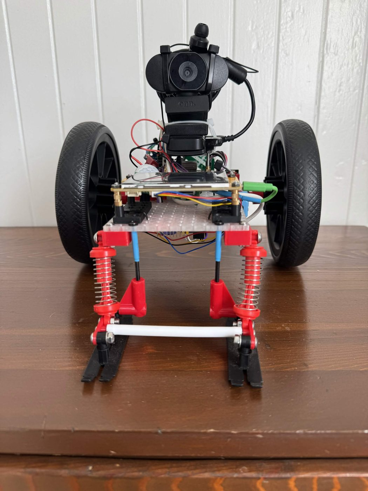
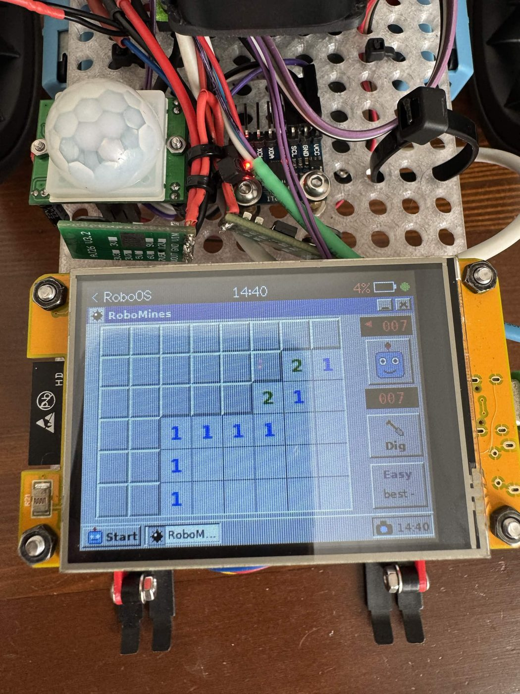
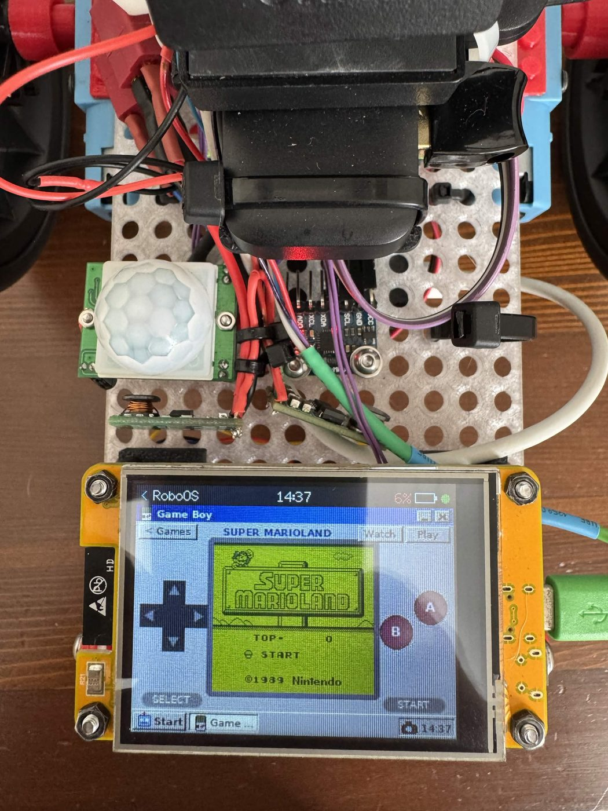
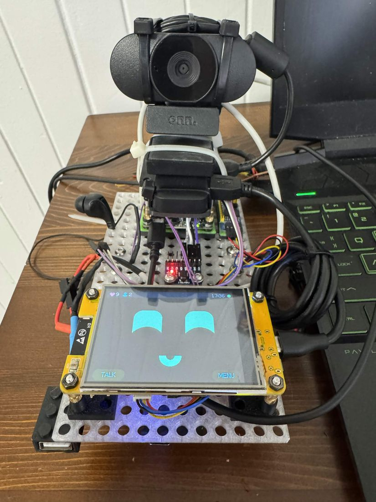
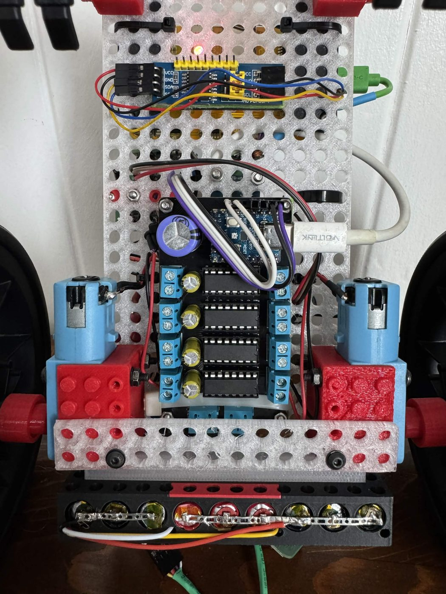
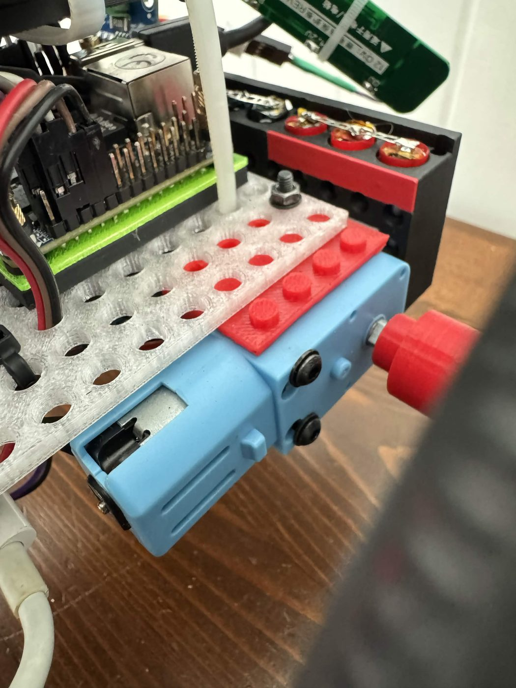
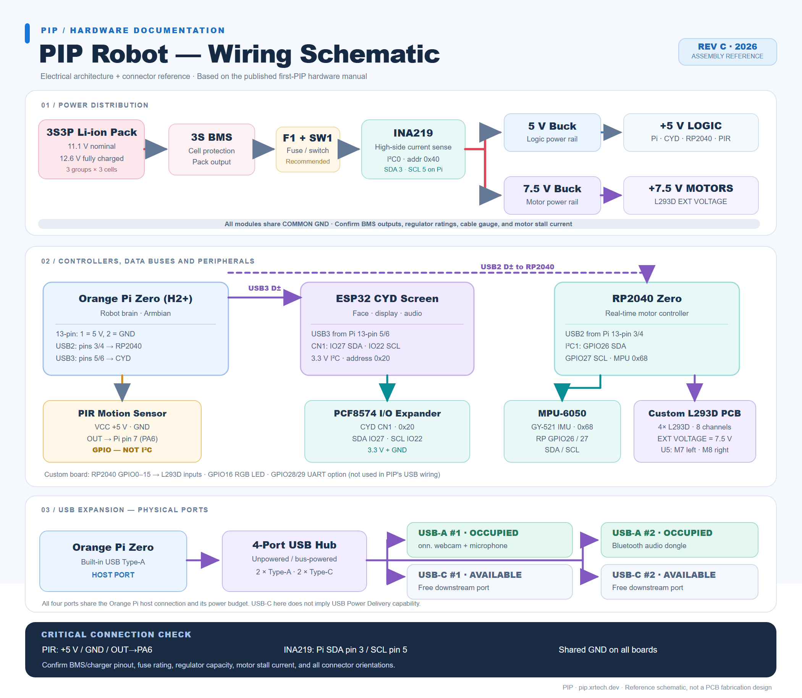

# Start here

Pip is three projects that work together. You can build one, two or all three, and you can start small and add
the rest later. Nothing on this page needs soldering until the last step.

<!-- photo still wanted: all three builds side by side (RoboOS on a Pi, a desk Pip, the rolling Pip). -->

## Pick your build

| Build | What you get | What you need | Soldering? | Battery? |
|---|---|---|---|---|
| **1. RoboOS** | A tiny touch desktop with a terminal, web browser, games, an app store and a Game Boy emulator | Any Pi or small Linux board, a CYD touchscreen (about $15), a USB cable | No | No |
| **2. Desk Pip** | A robot that sees, hears, talks, remembers and plays games, sitting on your desk | Build 1, plus a USB webcam and a speaker | No | No, USB power |
| **3. Rolling Pip** | Desk Pip on wheels: it drives, follows a joystick and does wheelies | Build 2, plus a motor board, two gear motors and a battery | Some | Yes |

If you are new to this, or building with kids, start with **Build 1** or **Build 2**. They run from a USB power
supply, so there are no lithium batteries to worry about.

## Build 1: RoboOS on a $15 screen

RoboOS is the desktop that runs on Pip's face, and it works fine without the robot. Plug a CYD
(ESP32-2432S028R, the "Cheap Yellow Display") into any small Linux computer by USB, and that computer gets a touch
desktop.

*RoboOS on Pip's screen, playing RoboMines.*

1. Get the parts: a **CYD (ESP32-2432S028R)** and a Raspberry Pi, Orange Pi or old laptop running Linux.
2. Follow the install steps in the RoboOS repo: <https://github.com/cperos-xr/roboos>. You write the screen's
   firmware once, run `./install.sh`, and start it.
3. Open the **App Store** on the screen and install an app, such as Dice or Stopwatch.
4. Open the **Game Boy** app and load a game you own or a free homebrew game. On Pip, the AI can watch you play and
   give tips.

   
5. Want to make your own app? Read
   [WRITING_APPS.md](https://github.com/cperos-xr/roboos/blob/main/docs/WRITING_APPS.md). Apps are one small Python
   file plus a short `app.json`, and the store checks every app automatically before it is listed.

## Build 2: Desk Pip

Desk Pip is the robot without wheels. Most of what Pip does needs no motors at all.

*The first Pip was a Desk Pip for its first weeks, before it got wheels.*

1. Plug the screen, a USB webcam (with a microphone) and a speaker into the brain. A USB hub helps.
   See [YOUR_PARTS.md](YOUR_PARTS.md) for what can do each job.
2. Power the brain from a good USB supply. A weak supply causes random resets: see [POWER.md](POWER.md).
3. On your computer, open this repo in Claude Code and type `/make-it-alive`. It finds the brain, installs
   everything, and has the robot say its first words. The full walk-through is in [MAKE_IT_ALIVE.md](MAKE_IT_ALIVE.md).
4. Open `http://pip.local:8080` on your phone and say hello.

## Build 3: Rolling Pip

 

*Left: underneath, the L293D board with its RP2040 Zero between the two gear motors, and the battery pack at the
back. Right: a gear motor held to the frame by a printed stud plate.*

**Wiring it:** [WIRING.md](WIRING.md) has the map, the full schematic with pin numbers, a table of every connection
and the order to do it in.

1. **The motor board.** The first Pip uses an RP2040 Zero on an L293D board
   ([cperos-xr/l293d](https://github.com/cperos-xr/l293d)), which drives up to 8 motors. Any small board that
   understands four text commands works too: see "The motor board is just a few text commands" in
   [YOUR_PARTS.md](YOUR_PARTS.md).
2. **Mount everything.** Print stud plates for each board with the LEGO-ifier: [MOUNTING_BOARDS.md](MOUNTING_BOARDS.md).
3. **Power.** Motors need more than USB can give. Read [POWER.md](POWER.md) before you connect a battery.
4. **Unlock the motors.** Motors stay locked until the owner unlocks them, and the motor board stops by itself after
   half a second without commands.
5. **Teach it to balance.** Each Pip learns its own balance point for wheelies: [WHEELIES.md](WHEELIES.md).

## Get help

- **Discord:** <https://discord.gg/reAxepKxf4>. Ask in #build-help and show your build in #show-your-build.
- **GitHub issues:** if a step in these docs was wrong for your hardware, please open an issue or a pull request.
  The next builder will hit the same problem.
- **Your AI helper:** Claude Code can read the robot's logs and its manual (`knowledge/manual/`). Tell it what
  happened.

## Give something back

- **Write a RoboOS app** and send it to the store: <https://github.com/cperos-xr/roboos-apps>.
- **Add a part.** Got a new sensor or board working? Add an entry to `knowledge/parts.yaml` so the next person can
  just plug it in.
- **Fix a doc.** Every page here was written from one working robot. Your build will find what is missing.
