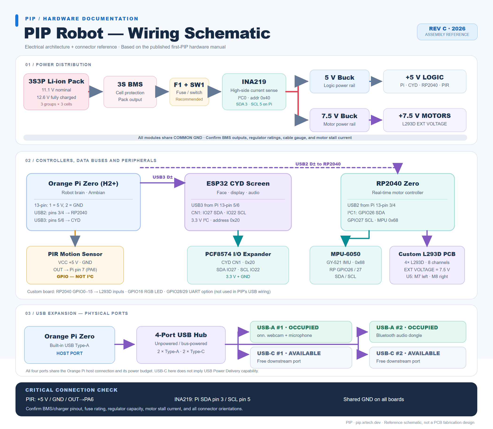
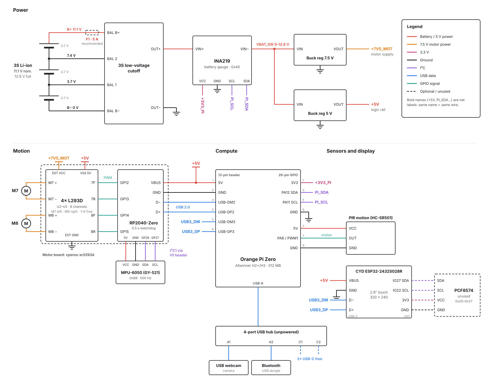

# Wiring Pip, step by step

This is how the first Pip is wired, in the order to do it. Yours can be different: every part is optional, and
[YOUR_PARTS.md](YOUR_PARTS.md) lists what else can do each job. Power and the battery are explained in
[POWER.md](POWER.md).

**Work with the power off.** Unplug the battery and USB before you move any wire.

## The map

## The schematic, with pin numbers

Net labels such as `+5V`, `PI_SDA` or `USB3_DM` mean "the same wire": every place with the same name is connected.
Editable sources for both drawings are in [`img/PIP_robot_wiring_revC_package/`](img/PIP_robot_wiring_revC_package/).

## Every connection in one table

| From | To | Notes |
|---|---|---|
| 5 V regulator VOUT | Orange Pi 13-pin header **pin 1** (5 V) and the USB hub's 5 V | Jumpered together. The CYD and RP2040 get 5 V through the same pin. |
| 5 V regulator GND | 13-pin header **pin 2** (GND) | All grounds are joined. |
| 13-pin **pin 3** (D−) and **pin 4** (D+) | RP2040 Zero, through a USB-C cable | USB2. Needs the `usbhost2` overlay ([INSTALL.md](INSTALL.md), step 2). |
| 13-pin **pin 5** (D−) and **pin 6** (D+) | CYD screen, through a USB-C cable | USB3. Needs the `usbhost3` overlay. |
| 7.5 V regulator VOUT, GND | L293D board **EXT VOLTAGE** (through a T-plug) | Motor power only. |
| +5 V | L293D board **VSS** (logic 5 V) | |
| L293D **U5** motor 7 | Left wheel motor | RP2040 GPIO 12 (forward) and 13 (reverse). |
| L293D **U5** motor 8 | Right wheel motor | RP2040 GPIO 14 (forward) and 15 (reverse). |
| MPU-6050 (GY-521) VCC, GND | +5 V, GND | |
| MPU-6050 SDA, SCL | RP2040 **GPIO 26** (SDA), **GPIO 27** (SCL) | The motor board reads the tilt 500 times a second for wheelies. |
| INA219 VCC, GND | Orange Pi 26-pin **pin 1** (3.3 V), **pin 6** (GND) | |
| INA219 SDA, SCL | 26-pin **pin 3** (SDA), **pin 5** (SCL) | I2C bus 0, address 0x40. |
| INA219 Vin+ / Vin− | Protection board + output / the robot's + feed | In the positive wire only. |
| PIR VCC, GND | 26-pin **pin 2** (5 V), **pin 9** (GND) | On 3.3 V it triggers by itself. |
| PIR OUT | 26-pin **pin 7** (PA6) | Its output is 3.3 V, safe for the Pi. |
| PCF8574 (optional, unused now) | CYD **CN1**: IO27 (SDA), IO22 (SCL), 3.3 V, GND | Address 0x20. Spare inputs and outputs. |
| Webcam, Bluetooth dongle | USB hub, on the Pi's USB-A port | |

## In order

### 1. The brain and the screen, on USB power

1. Make the two USB cables for the 13-pin header: cut a USB-C cable, and connect **red** to pin 1 (5 V), **black** to
   pin 2 (GND), **white** to D− and **green** to D+. Cheap cables do not always follow these colours: check each wire
   with a meter first.
2. CYD cable: D− to pin 5, D+ to pin 6. RP2040 cable: D− to pin 3, D+ to pin 4.
3. Plug the webcam and the Bluetooth dongle into the USB hub, and the hub into the Pi.
4. Power the Pi from USB and install the software ([MAKE_IT_ALIVE.md](MAKE_IT_ALIVE.md)). Run the self-tests: the
   screen, camera and motor board should all show up before you go further.

### 2. The sensors

1. **PIR:** VCC to pin 2, GND to pin 9, OUT to pin 7 of the 26-pin header.
2. **MPU-6050:** onto the RP2040 (5 V, GND, GPIO 26, GPIO 27). After you mount it, run the wheelie setup once
   ([WHEELIES.md](WHEELIES.md)).
3. **INA219:** VCC to pin 1 (3.3 V), GND to pin 6, SDA to pin 3, SCL to pin 5. Wrap the plug in tape so it cannot
   come off (the first Pip's is the blue one).

### 3. The battery side

1. Build or buy the pack and check its balance taps: [POWER.md](POWER.md).
2. Pack → protection board, through the pack's **4-pin balance plug**, not its main (Deans) plug: the protection board
   needs all four voltages. Then protection board → INA219 (in the + wire) → T-plug. Mark the 0 V side of the 4-pin
   plug: it fits either way round. Never connect the pack without the protection board ([POWER.md](POWER.md)).
3. **Set both regulators and measure them with nothing connected:** 5.0 V and 7.5 V. A regulator on the wrong pad can
   destroy the Pi in a second.
4. Only then connect: 5 V to the 13-pin header and the hub, 7.5 V (through its T-plug) to the motor board.

### 4. The motors

1. Motor 7 (left) and motor 8 (right) on the right-hand L293D (U5).
2. Unlock the motors in the app and drive forward slowly. If a wheel turns backwards, swap that motor's two wires.

## Before you plug in the battery

- The pack goes in by its 4-pin balance plug, **0 V to 0 V**. A reversed plug burned out a charger.
- The protection board is in the circuit. Without it, the regulators and motor board drain the pack until it is ruined.
- No short between the battery + and −: check with a meter on its continuity setting.
- Both regulator outputs measured, with nothing connected.
- Every ground joined: the pack's −, both regulators, the Pi, the motor board.
- Plugs snug. A loose plug on a wheelie can reset the whole robot.
